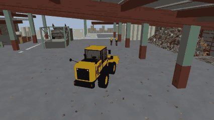
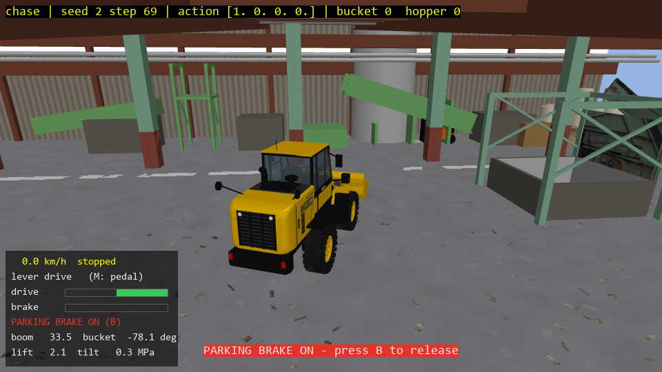
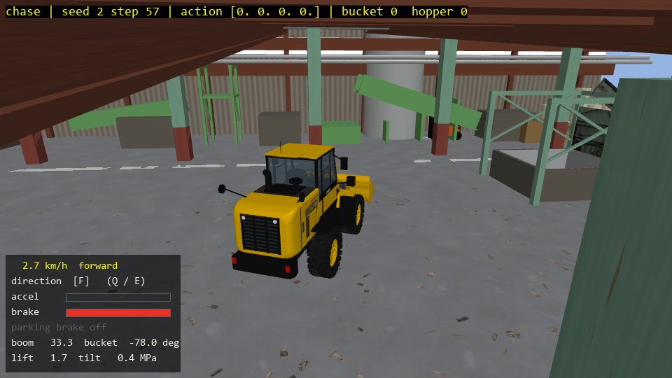

# CardboardYardReal simulator v5 (standalone)

A Komatsu WA100-8 wheel loader in a 3D MuJoCo copy of the real recycling site: it scoops cardboard from a
pile and dumps it into the hopper, with obstacles and people walking around. Physics v4 = hydraulics with
force / flow limits and lift / tilt cylinder pressures. This is the same simulator (same code, same
physics) that made the v4 world-model dataset. The folder runs on its own, without the stable-worldmodel project.

The loader body mesh is a CC BY-NC-SA scan (non-commercial, credit the author): see
`cardboard_yard_real/assets/komatsu_scan/LICENSE.txt`.



The scripted expert fills the hopper (chase camera, 2x speed). Full 4-camera video (chase, top, cab, rear): [media/demo.mp4](media/demo.mp4).

| Manual drive, parking brake on | Pedal mode, braking |
|---|---|
|  |  |

## New in v5 (2026-11-13)

v5 = the v4 simulator + brakes and better manual controls. v4 itself is unchanged: `--physics v4` (and any
4-number action in v5) steps bit-for-bit like the simulator that made the v4 dataset (`test_v5.py` checks this).

| New | What it is |
|---|---|
| Brake pedal | Space (or S in pedal mode, or the left trigger): cuts the drive and stops the machine faster than releasing the lever. Analog: 0..1. |
| Parking brake | B: holds the machine, the drive lever does nothing until you release it. Put on while moving = full brake. |
| Pedal drive mode | M (or `--drive-mode pedal`): direction selector F / N / R (E / Q) + accelerator pedal (W), like the real HST machine. |
| Status panel | Bottom left: speed (km/h), direction, drive / accelerator / brake bars, parking brake, boom and bucket angle, lift / tilt pressure. H hides it. |
| CSV | v5 drives have two more action columns: `brake_pedal`, `park_brake`. `_start.npz` also holds the physics profile, so `replay.py` picks it by itself. |

Stopping from full speed (3 m/s = 10.8 km/h), measured with `test_v5.py`:

| How | Time | Distance |
|---|---|---|
| lever released (v4 behaviour, HST slow-down) | 3.1 s | 4.7 m |
| brake pedal half | 1.5 s | 2.2 m |
| brake pedal full / parking brake | 1.0 s | 1.4 m |

Limits of the brake model (be aware when you use the data):
- The full-brake deceleration (3.5 m/s2, `brake_decel` in `cardboard_yard_real/physics.py`) is an estimate, not
  from a Komatsu data sheet.
- The loader is driven by a speed controller on a flat floor: the brake makes the commanded speed drop faster.
  There are no brake discs, no wheel lock / skid, and no slopes, so "holds on a slope" cannot be tested here.
- The v4 dataset's expert (`demo.py`, expert v1) does not use the brake: it drives exactly as in v4. The braking
  expert is `--expert v2` (below).
- Hard braking with a full, raised bucket can throw cardboard out (the pieces are real bodies), as on the real machine.

### Braking expert (expert v2)

`cardboard_yard_real/expert_v2.py` (`LoaderExpertPolicyV2`) is the v4 dataset's expert plus the brake pedal, for
collecting v5 data that contains braking. Planning, steering and arm work are unchanged; it only adds the pedal:

- safety stop for a person or for a column / wall / the hopper: full brake while still rolling, then (person) a
  light brake held while it waits
- ordinary stops and direction changes: a soft brake, harder at speed, softer with a loaded bucket
- no brake while it drives on; the parking brake is never used

```
.venv\Scripts\python.exe demo.py --expert v2 --viewer            # physics v5 by default with expert v2
.venv\Scripts\python.exe demo.py --expert v2 --csv ep.csv --steps 3000
```

Check against expert v1 on physics v5, seeds 0-7, up to 2000 steps each, no noise (small sample; single seeds
differ a lot either way because cardboard contacts amplify small changes):

| | expert v1 | expert v2 |
|---|---|---|
| pieces in the hopper (8 episodes) | 175 | 205 |
| episodes that reached the hopper target | 5 | 6 |
| steps used | 12190 | 10909 |
| people touched | 0 | 0 |
| steps touching a column / wall / the hopper | 14 | 2 |
| steps with the brake pedal down | 0 | 433 (4.0 %) |

Old v4 data stays usable: v4 episodes with `brake_pedal = 0`, `park_brake = 0` added are valid v5 data
(v5 without brake input is bit-equal to v4).

## Setup (once)

1. Install Python 3.10 or newer from python.org (tick "Add python.exe to PATH").
2. Double-click `setup.bat`. It creates `.venv` here and installs the packages from `requirements.txt`.

## Run

| File | What it does |
|---|---|
| `run_manual.bat` | You drive the loader with the keyboard; each drive is saved as a CSV in `drives\` |
| `run_demo.bat` | The built-in expert drives; a 3D MuJoCo window shows it (mouse: rotate / zoom) |
| `run_replay.bat` | Watch a saved drive again: drag a CSV onto it (or `run_replay.bat drives\<file>.csv`) |

The first time, `run_*.bat` runs `setup.bat` by itself if `.venv` is missing.

From a terminal instead (in this folder):

```
.venv\Scripts\python.exe manual.py --camera top --seed 3
.venv\Scripts\python.exe demo.py --viewer --steps 3000
.venv\Scripts\python.exe demo.py --video yard.mp4 --steps 700    # 2x2 camera video, no window
.venv\Scripts\python.exe demo.py --csv ep.csv --steps 3000       # per-step data as CSV (see below)
.venv\Scripts\python.exe replay.py drives\drive_20261030_101500_seed0.csv   # watch a saved drive again
```

The first start takes a minute or two (it loads the meshes and textures). Rendering video is slow on a laptop.

## Keys (manual.py, hold the key)

| Key | Action |
|---|---|
| W / S | drive forward / back (lever mode) |
| Space | brake pedal |
| B | parking brake on / off |
| M | drive mode: lever <-> pedal |
| W, S, E / Q | pedal mode: W accelerator, S brake, E / Q direction up / down (R - N - F; starts in N) |
| H | status panel on / off |
| A / D | steer left / right |
| I / K | boom up / down |
| J / L | bucket curl (lip up, holds the load) / dump (lip down) |
| C | next camera: chase, top, cab, rear |
| P | save the drive so far now (you can keep driving) |
| R | save this drive, then start a new episode (new random yard, seed + 1) |
| Esc | save this drive, then quit |

## Joystick / gamepad

`manual.py` also reads a joystick or gamepad (Xbox / PlayStation pad, USB joystick). Plug it in **before**
starting `run_manual.bat`; the console then prints `joystick: <name>`. The sticks are analog: a half-pushed
stick gives about 0.5, so drives are smoother than with keys (keys give only -1, 0, +1). Keys keep working; a
held key wins over the stick on that lever.

Default layout (Xbox-style pad):

| Stick / button | Action |
|---|---|
| left stick up / down | drive forward / back |
| left stick left / right | steer left / right |
| right stick up / down | boom up / down |
| right stick left / right | bucket curl (lip up) / dump |
| left trigger (axis 4) | brake pedal (`--joy-brake <axis>`, -1 = none) |
| right trigger (axis 5) | accelerator in pedal mode (`--joy-accel <axis>`) |
| LB / RB (buttons 4 / 5) | direction down / up in pedal mode |
| button 1 (B) | parking brake on / off |
| button 0 (A) | save the drive now (like P) |
| button 7 (Start) | new episode (like R) |

Other joysticks number their axes differently. Find yours with
`.venv\Scripts\python.exe joy_test.py` (move each stick and see which axis number changes), then set
`--joy-map` (axis numbers for drive, steer, boom, bucket) and `--joy-invert` (1 = flip that axis) when a lever
goes the wrong way, and `--joy-dead` for the dead zone (default 0.1):

```
.venv\Scripts\python.exe manual.py --joy-map 1,0,3,2 --joy-invert 1,1,1,1 --joy-dead 0.1
```

Joystick drives are saved and replayed exactly like keyboard drives (the CSV holds the analog values).

## When an episode ends

| Event | What happens |
|---|---|
| The loader touches a **person** | The episode ends at once (reward -10). The window shows `HIT_WORKER | END (R = new episode)` and the loader no longer moves, whatever keys you press. Press **R** for a new episode (new random yard, seed + 1) or **Esc** to quit. |
| **25 pieces** are in the hopper | The episode ends (success), same `END` line. Press **R** for a new one. |
| The loader touches a column, wall, pallet or the hopper | The episode goes on. The top line only shows `HIT_STATIC` or `HIT_OBSTACLE` while it touches. |

The drive up to the end is saved automatically (see below), also after an accident.

## Save a manual drive and watch it again

1. Drive with `run_manual.bat`. When you press R or Esc, or the episode ends, the drive is saved in the
   `drives` folder as two files:
   - `drives\drive_<date>_<time>_seed<N>.csv`: one row per step: time, your 4 actions and the 12 proprio values
     (columns in "Data per step" below). Open it in Excel or Python.
   - `drives\drive_<date>_<time>_seed<N>_start.npz`: how the episode started (seed, full sim state). Keep it
     next to the CSV: without it the replay cannot rebuild the same yard.
   `manual.py --no-save` turns saving off; `--out-dir D:\mydrives` saves elsewhere.
2. Watch it again: drag the CSV onto `run_replay.bat`, or
   ```
   .venv\Scripts\python.exe replay.py drives\drive_20261030_101500_seed0.csv               # window (C camera, Space pause, Esc quit)
   .venv\Scripts\python.exe replay.py drives\drive_20261030_101500_seed0.csv --video d.mp4  # 2x2 camera video
   .venv\Scripts\python.exe replay.py drives\drive_20261030_101500_seed0.csv --check        # only compare
   ```
   The replay starts the same yard from the seed and feeds the CSV's actions step by step, so the loader, the
   cardboard and the people move exactly as in your drive. At the end it prints how far the replayed loader is
   from the CSV: a manual or demo drive gives 0.000 m (tested: 600 and 1000 steps).
3. You can also edit the action columns of a CSV (e.g. in Excel, keep the column names) and replay it: the
   loader then does your edited drive in the same yard. The proprio columns are only used for the comparison.

`demo.py --csv ep.csv` saves the expert's drive the same way (`ep.csv` + `ep_start.npz`).

### Replay an episode from the v4 dataset

Dataset episodes exported with `cy_export_csv.py --start` (office PC, `C:\office-projects\sim_csv`) come with a
`_start.npz` that holds the step-0 sim state but no seed. The replay starts from that state; it is close but not
bit-exact (the state does not hold the solver's warm start and the people's random generator): tested on a
3000-step episode, the loader stayed within 0.34 m of the recording (mean 0.23 m).

Notes:
- Keep the actions at full precision. The saved CSVs write them with 9 digits; rounding them to 5 digits
  already made a 1000-step replay drift by up to 0.35 m (cardboard contacts amplify tiny differences).
- Replay with the same physics profile as the drive. Drives saved by v5 programs store it in `_start.npz` and
  `replay.py` uses it; older drives and dataset episodes have none and replay with v4. `--physics` overrides.

## Data per step (one step = 0.1 s, 10 Hz)

Action, 4 numbers in [-1, 1]:

| # | Column | Meaning |
|---|---|---|
| 0 | drive | forward (+) / back (-) speed |
| 1 | steering | steer left / right |
| 2 | boom_lever | boom up (+) / down |
| 3 | bucket_lever | bucket curl (+, lip up) / dump |

With physics v5 the action may have two more numbers (leave them out, or 0, to drive as in v4):

| # | Column | Meaning |
|---|---|---|
| 4 | brake_pedal | 0 (up) .. 1 (fully down): cuts the drive, stops faster |
| 5 | park_brake | 1 = on (above 0.5): machine held, drive ignored |

Proprio, 12 numbers (`env._proprio()`):

| # | Column | Meaning |
|---|---|---|
| 0, 1 | pos_x_m, pos_y_m | machine position (m, world frame) |
| 2, 3 | yaw_cos, yaw_sin | heading |
| 4, 5 | vel_x_mps, vel_y_mps | velocity (m/s, world frame) |
| 6 | steer_angle_rad | articulation angle |
| 7 | boom_angle_rad | boom angle |
| 8 | bucket_angle_rad | bucket angle |
| 9 | yaw_rate_radps | turning rate |
| 10, 11 | lift_cyl_pressure_mpa, tilt_cyl_pressure_mpa | lift / tilt cylinder pressure (MPa) |

`demo.py --csv` writes these with `time_s`, `step` and `yaw_deg`, the same columns as the CSVs exported from the dataset.

## Files

| Path | Content |
|---|---|
| `cardboard_yard_real/env.py` | the environment `CardboardYardRealEnv(physics='v4')` or `physics='v5'` (gymnasium API) |
| `cardboard_yard_real/expert_v1.py` | scripted expert `LoaderExpertPolicyV1` (the v4 dataset's expert) |
| `cardboard_yard_real/expert_v2.py` | `LoaderExpertPolicyV2`: expert v1 + brake pedal (physics v5) |
| `cardboard_yard_real/physics.py`, `hydraulics.py`, `people.py`, `wa100_*.py` | physics profiles, hydraulics, walking people, the WA100-8 model |
| `cardboard_yard_real/assets/` | textures, meshes, the scanned loader body, mesh cache |
| `cardboard_yard/` | the base environment and expert it builds on |
| `demo.py`, `manual.py`, `replay.py` | the programs above |
| `recording.py` | saves / loads a drive (CSV + `_start.npz`) |
| `joy_test.py` | shows a joystick's axis / button numbers (for `--joy-map`) |
| `controls.py` | pedal drive mode and gamepad triggers for `manual.py` |
| `test_v5.py` | checks: v5 without brake = v4, stopping distances, parking brake, save / replay with brake columns |

Use in your own code:

```python
import sys; sys.path.insert(0, r'path\to\this\folder')
from cardboard_yard_real import CardboardYardRealEnv
from cardboard_yard_real.expert_v1 import LoaderExpertPolicyV1
env = CardboardYardRealEnv(physics='v4', camera='top')
obs, info = env.reset(seed=0)
policy = LoaderExpertPolicyV1(seed=0)
obs, reward, terminated, truncated, info = env.step(policy.act_single(env))
img = env.render()           # 224x224 RGB from the top camera (what the world model sees)
# physics='v5': env.step([drive, steer, boom, bucket, brake_pedal, park_brake]); env.forward_speed() in m/s
proprio = env._proprio()     # the 12 values above
```
